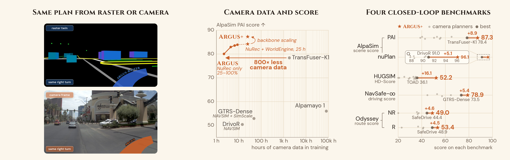

# Argus: From Rasterized-Camera Self-Play to Real-Camera Driving

[Yuan Yin](https://yuan-yin.github.io/)1,\*, [Elias Ramzi](https://elias-ramzi.github.io/)1,\*, [Tuan-Hung Vu](https://tuanhungvu.github.io/)1, [Marc Lafon](https://marclafon.github.io/)1, [Yihong Xu](https://www.linkedin.com/in/yihong-xu-326285109/)1, 
[Éloi Zablocki](https://eloiz.github.io/)1, [Alexandre Boulch](https://www.boulch.eu/)1, [Andrei Bursuc](https://abursuc.github.io/)1, [Matthieu Cord](https://cord.isir.upmc.fr/)1,2

1valeo.ai, Paris, France · 2Sorbonne Université, CNRS, ISIR, Paris, France · \*Equal contribution

*Driving learned by reinforcement learning in simulation, carried to real cameras.*

**[Project page](https://valeoai.github.io/Argus) · [Videos](https://valeoai.github.io/Argus#videos)**

## Abstract

Self-play reinforcement learning (RL) in simulation lets driving scale with compute rather than with logged human data, but learning from scratch takes billions of steps, so observations must be cheap to render. Rasterized camera views show what driving mostly depends on, the road, lanes, road users, and traffic lights, at a fraction of the cost of realistic images, and through a pretrained image encoder such as DINOv3, a real camera image resembles its raster.

We present **Argus**, a camera policy that inherits all of its driving skills from *Argus-Raster*, a raster policy trained by self-play, interleaved toward the end of its training with single-agent PPO in logged scenes. Only its pretrained image encoder is aligned: it learns to match *Argus-Raster*'s features on a raster twin of the scene, drawn from the perception labels that driving datasets provide. Its driving comes from 5M hours of RL in simulation, so Argus needs little camera data. Aligned on only 2.2 hours of reconstructed camera views of driving scenes, it already beats the best camera planner on AlpaSim PAI, a model trained on 1,800 hours of driving. Aligned on 25 hours of such views, Argus outperforms in closed loop on AlpaSim and HUGSIM every camera policy we compare with, learned by imitation or transferred from self-play, by 5.8 points on PAI and 4.9 on nuPlan, and *Argus+*, with a larger image backbone, leads on every benchmark we evaluate, with 87.3 on PAI.

## Driving examples

Closed-loop drives of Argus in AlpaSim, on PAI validation scenes reconstructed with NuRec, are on the [project page](https://valeoai.github.io/Argus#videos).
